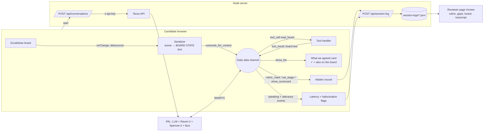

# Board Interviewer: first-round system design screening on Tavus CVI

A company sends a candidate a link. An AI interviewer (a Tavus PAL) runs the first-round system design interview while the candidate draws on a live Excalidraw board **in the same page**. The PAL reads the board as structured data (boxes, labeled arrows, notes), not pixels, so it never invents lines that aren't there. The candidate sees a neutral interviewer; the hiring team gets a rubric with evidence, a requirements gap table, the final board, the transcript and latency on a separate review page.

| | |
|---|---|
| **Who uses it** | **Candidate:** name, interview, "thank you, submitted". No scores, no stages. **Reviewer (hiring team):** `/review` page per session, or `?reviewer=1` to watch live. |
| **Why this project** | System design screens are expensive: a senior engineer for 45 minutes per candidate, and most first rounds end in "no". An AI first round frees that time, but only if it can follow a whiteboard. I tried exactly that on Tavus as a customer: screen-share vision misread my board (missed labels, hallucinated arrows), lists were read aloud and turns felt slow. This app engineers around each gap the way a Customer Engineer would for a customer, and measures the result. |
| **Call length** | One setting, `TAVUS_MAX_CALL_SECONDS`. The demo uses 480 (8 min) to stay inside the trial minutes; a real screen would use 1800 to 2700 (30 to 45 min). Tavus `max_call_duration`, the countdown, the 1-minute wrap-up and the spoken intro all read it. |
| **Scope** | `INTERVIEW_SCOPE`: `screen` (default) covers requirements + high-level design, which fits 8 minutes; `full` covers every area for a 30 to 45 minute call. Out-of-scope rubric areas show as "Not in scope" and do not count against the score. |
| **Fairness** | Any framework or order is accepted (no fixed stage order; guardrail `no_framework_penalty`). Rubric items are outcomes, not steps. The interviewer answers only what is asked and nudges once, without the answer, if an area is untouched. |
| **Tavus features used** | PAL + guardrails (4) + tools registry (`/v2/tools`, app-message delivery, `on_resolve`), Interactions Protocol (`conversation.overwrite_llm_context`, `conversation.tool_call` / `tool_result`, `conversation.respond`, utterance and speaking events), `custom_greeting`, `conversational_context`, Raven-2 perception, Sparrow-2 turn taking (`idle_engagement: off`) |
| **Stack** | Vite + React 19, `@excalidraw/excalidraw`, `@daily-co/daily-js` (custom call object layout), Express (keeps the API key server-side) |
| **Time box** | ~4 hours |

## Architecture



| Gap seen as a customer | Workaround in this app |
|---|---|
| Vision misses board labels, says there are lines when there are none | Board is serialized from the scene graph and pushed with `conversation.overwrite_llm_context` on every meaningful change. Prompt: "the only truth about the board is BOARD STATE". The text says "There are NO lines or arrows" when that's true. |
| Model talks about the board from memory | `read_board` tool (`on_resolve: generate_response`) returns the exact current board before it comments |
| Reads long lists aloud | `show_list` renders on screen; the prompt bans reading more than two items aloud |
| Lists filled from the brief instead of what the candidate said | `show_list` items are the candidate's words only; brief items never raised go to `not_raised`, shown to reviewers only |
| Can't share an Excalidraw screen reliably | The board is embedded next to the video, so no screen share is needed (share is still available) |
| Interviewer re-asks while the candidate is silently drawing | `idle_engagement: off`, a "silence is work" rule, and every board push says "Candidate is drawing right now" |
| Calls get cut before wrap-up | Countdown. At 2 min left Anna says so (`conversation.echo`) and invites the candidate to summarise; at 60 s she marks evidence and the scorecard silently; at 25 s she closes. The log is saved even when Tavus ends the call |
| Feels slow | Measured per session: create, join, click-to-first-words, per-turn latency p50/p90 |

## Session flow

1. **Start:** candidate enters a first name (required) and starts.
2. **Intro:** `custom_greeting` says the interviewer's name, the length, how the board and library work, and the question.
3. **Interview:** the candidate clarifies and designs in their own order. The PAL marks a 10-item outcome rubric silently (`rubric_mark`) and records the topic timeline (`set_stage`).
4. **End:** the PAL records a scorecard (`show_scorecard`, hidden from the candidate). The candidate sees "Thank you, submitted to the hiring team".
5. **Review:** `/review` lists sessions with rubric %, verdict, evidence per item, requirements raised vs not raised, final board, transcript and latency.

## Run it

```
cp .env.example .env        # paste TAVUS_API_KEY
npm install
npm run setup               # creates/updates tools, guardrails and the PAL; writes TAVUS_PAL_ID
npm run dev                 # candidate: http://localhost:5173  reviewer: /review
```

Re-run `npm run setup` after changing `INTERVIEWER_NAME`, the prompt or the tools: it updates the same PAL in place. `DEFAULT_QUESTION` keeps runs comparable (`?q=rideshare` or `?q=random` overrides it). `?sync=off` is a control run with board sync disabled, to compare hallucination flags and latency.

**Future switch:** a practice mode (interviewer gives feedback and the scorecard to the candidate) is a prompt and view change, not a new app.

`npm test` runs the serializer, protocol, rubric, metrics and requirements-matching tests. `npm run build && npm start` serves the production build.

## Files

| Path | What |
|---|---|
| `src/board/serialize.ts` | Excalidraw scene → BOARD STATE text, diff, fingerprint |
| `src/board/match.ts` | Is a spoken requirement also written on the board |
| `src/board/library.ts` | 21 ready-made components (database, queue, billing API, CRM…) |
| `src/Interview.tsx` | Room: board, video, tool handling, context pushes; reviewer panels behind `?reviewer=1` |
| `src/Review.tsx` | Reviewer page |
| `src/tavus/protocol.ts`, `src/tavus/metrics.ts` | Interaction builders and tool_call parser; latency and hallucination measurement |
| `shared/system-prompt.txt`, `shared/tools.mjs`, `shared/prompts.mjs`, `shared/rubric.mjs`, `shared/policies.mjs` | PAL prompt, tools, questions, rubric, guardrails |
| `scripts/setup-pal.mjs` | Creates or updates tools, guardrails and the PAL |
| `server.mjs` | Config, conversation create/end, session logs |
